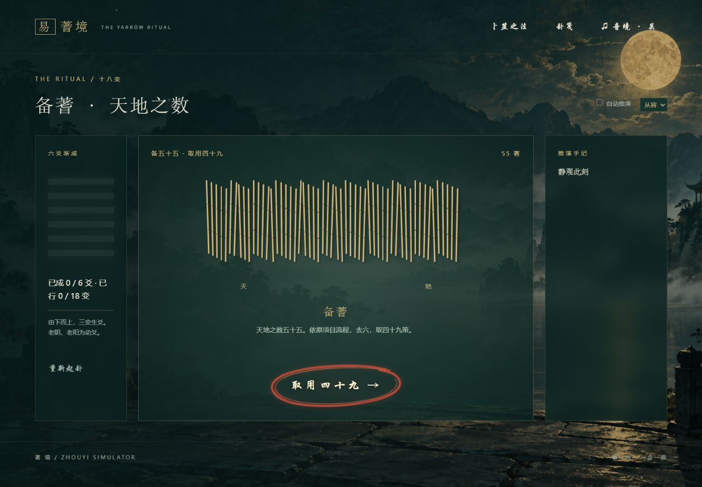

# ZhouyiSimulator

周易占卜模拟器：模拟蓍草卜卦完整过程可视化，卦象推演及解释过程辅以易经／易传参考文献。

## 蓍境 · 可视化蓍草卜卦

月下山水中的完整十八变体验：手动分蓍或自动推演，配合蓍草动画、五声音阶音乐、朱砂毛笔按钮，以及本卦、之卦、动爻和 64 卦经文。卦笺支持本地留存、文本下载和高清图片导出。

## 体验预览

### 净心启筮 · 月下山水

写下所问，从四十九策开始。鼠标悬停时文字泛起金光，点击时朱砂笔迹由浓到淡画出一圈，下图捕捉了落笔瞬间。


### 十八变 · 六爻渐成

在中央蓍草台逐步分蓍、挂一、揲四、归奇；左侧展示六爻进度，右侧记录每次推演。也可以切换自动推演，配合音境慢慢观卦。



### 留住此刻 · 山水卦笺

成卦后可保存完整文本，或将所问、本卦、之卦、卦辞与动爻绘成高清图片。下图为实际导出的卦笺示例；点击图片可查看原图。

<a href="web/assets/reading-card-example.png"></a>

## 启动网页服务

准备：安装 Node.js（建议 22 或更新版本），在终端执行 `node --version` 确认可用。网页不需要安装 npm 依赖，也不需要 Python 或 API 密钥。

首次获取项目：

```sh
git clone https://github.com/okcd00/ZhouyiSimulator.git
cd ZhouyiSimulator
```

在仓库根目录启动：

```sh
node web/serve.cjs
```

看到 `Local: http://127.0.0.1:4173` 后，在浏览器打开：

**[http://127.0.0.1:4173](http://127.0.0.1:4173)**

Windows 上，如果项目位于 `D:\Github\ZhouyiSimulator`，也可以在 PowerShell 中运行：

```powershell
cd D:\Github\ZhouyiSimulator
node web\serve.cjs
```

- 使用期间保持启动服务的终端运行；按 **Ctrl+C** 停止服务。
- 服务只监听本机 `127.0.0.1:4173`，不会开放到局域网。
- 若提示 `EADDRINUSE`，表示端口已被占用；如果此前已启动本项目，直接访问上述地址即可，或先在原终端停止旧服务。
- 修改网页文件后刷新浏览器即可；修改服务脚本后需停止并重新启动服务。
- 也可直接打开 `web/index.html` 浏览，但推荐通过本地服务使用，以获得稳定的浏览器存储和图片导出体验。

## 使用方式

1. 写下心中所问，点击「净心 · 启筮」。
2. 按步骤完成分二、挂一、揲四、归奇；也可开启「自动推演」。三变生爻，六爻成卦。
3. 「音境」控制背景音乐，「笔音」独立控制点击落笔音效。
4. 成卦后查看本卦、之卦、动爻与经典原文。
5. 点击「保存卦笺」：选「留下墨迹」下载完整文本，或选「绘成卦笺」，预览后点击「收藏图片」下载高清 PNG。
6. 顶部「卦笺」可以重读当前浏览器最近 30 次记录，并再次导出。记录保存在本地浏览器中，清除网站数据会清除记录，请下载需要长期保留的卦笺。

## 校验与数据更新

```sh
node web/test.cjs
node web/import-data.cjs
```

第一条命令校验 67,996 条合法三变路径、全部 64 卦映射与动爻翻转。第二条命令在修改 `references` 中的资料后重新生成网页经文数据。

原 Python 实现保留在 `src/`。网页算法与资产说明见 [web/README.md](web/README.md)。
